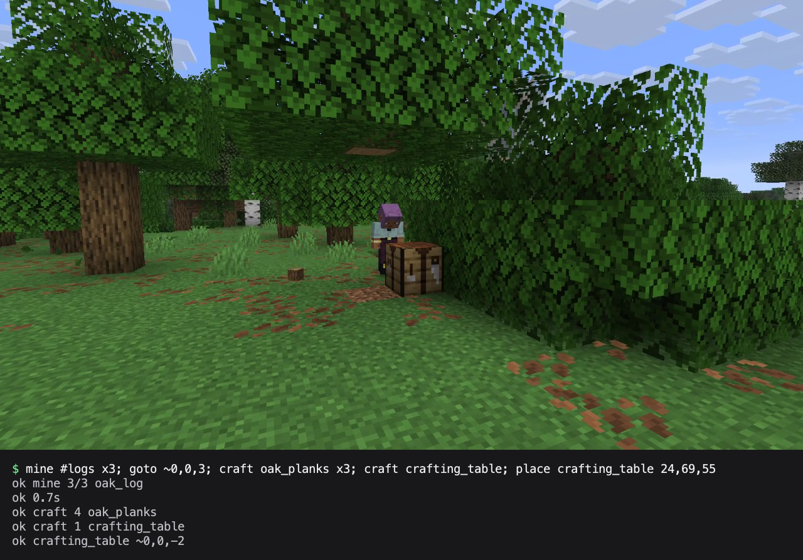
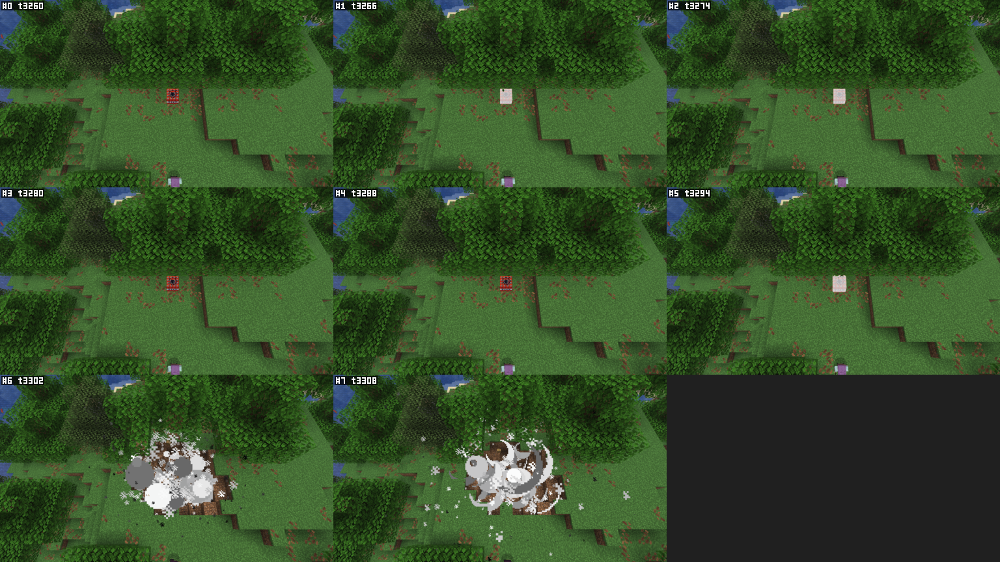

# Blockpilot

[](https://github.com/sparten11740/mc-blockpilot/actions/workflows/release.yml)

A client-side Minecraft mod that lets AI agents and scripts see and play the game through a fast, token-efficient local
interface: to play, or to play-test a mod while you develop it. For NeoForge and Fabric on Minecraft 1.21.1, 26.1.2,
26.2 and 26.3, and for plain Minecraft 26.1.2, 26.2 and 26.3 without a mod loader.



## Install

Put the jar for your loader and Minecraft version from the [releases](../../releases) into the game's `mods` folder
(Fabric also needs Fabric API) and start the game. Blockpilot listens on `127.0.0.1` only, behind a token it creates.
For a mod's dev environment, see [docs/dev-environment.md](docs/dev-environment.md).

Without a mod loader, on Minecraft 26.1.2, 26.2 or 26.3: keep that version's vanilla jar in a folder whose path has no
spaces, add an installation of that version in the Minecraft Launcher (or, where it offers that version, a vanilla
instance in the CurseForge app) and append `-javaagent:<full path to the jar>` to its JVM arguments; see
[docs/connecting.md](docs/connecting.md#without-a-mod-loader).

## Two ways to drive it

At every start the game writes a launcher, `<game dir>/blockpilot/blockpilot` (`blockpilot.cmd` on Windows), that
needs nothing else installed. The game dir is `~/Library/Application Support/minecraft` on macOS, `%APPDATA%\.minecraft`
on Windows and `~/.minecraft` on Linux, or the instance's folder in a launcher such as Prism or CurseForge.

**MCP, for AI agents.** The launcher serves MCP over stdio. Add it to your agent once; it keeps working through
restarts of the game. The agent gets three tools: `run` (a script of commands), `screenshot` and `help`.

```sh
claude mcp add --transport stdio blockpilot -- "<game dir>/blockpilot/blockpilot" --mcp
```

**Commands, from a shell or a script.** The launcher runs a script of commands, separated by `;`, and prints one
reply per command. The first `err` stops the script, and the exit code is 0 when every command answered `ok`.

```sh
"<game dir>/blockpilot/blockpilot" --wait-world "select iron_pickaxe; mine #logs x3; inv"
```

```
ok hand:iron_pickaxe
ok mine 3/3 oak_log
ok
  ~ 1:iron_pickaxe dur247/250
  + 5:oak_log x3
! got oak_log x3
```

Agents see what happens through replies, logs and screenshots, like this `screenshot burst=8 every=7t sheet` of TNT
going off:



The window can stay in the background. Real keyboard or mouse input stops what the agent is doing, and F8 turns agent
control off. MCP over HTTP, the raw line protocol and the launcher's options: [docs/connecting.md](docs/connecting.md).

## Commands

`help <command>` in the game gives a command's full form. Commands take an entity as `e<id>` or by its tag or custom
name as `@<name>`. [docs/commands.md](docs/commands.md) is the reference, and
[docs/command-language.md](docs/command-language.md) covers scripts, waits and assertions.

| Group | Command | What it does |
| --- | --- | --- |
| perception | `status` | Position, health, what the crosshair is on |
| | `look` | Blocks and entities around the player |
| | `entity` | One entity's position, motion and updates |
| | `find` | Nearest blocks or entities by id, tag, pattern or block state |
| | `block` | One block's state and light |
| | `blocks` | The blocks in a region |
| | `inv` | The inventory |
| movement | `face` | Aim at a position or entity |
| | `turn` | Set the camera's yaw and pitch |
| | `move` | Walk a direction for blocks or ticks |
| | `jump` | Jump |
| | `sneak` | Sneak, or tap sneak |
| | `sprint` | Sprint |
| | `fly` | Fly in creative |
| | `goto` | Walk to a position or entity along a path |
| interact | `use` | Use a block, entity or item |
| | `attack` | Hit entities |
| | `mine` | Break blocks by position or type |
| | `place` | Place an item against a block |
| inventory | `select` | Select a hotbar slot or item |
| | `swap` | Swap two inventory slots |
| | `drop` | Drop items |
| | `offhand` | Move an item to the offhand |
| | `equip` | Put on armour |
| | `open` | Open a container |
| | `take` | Take items from the open container |
| | `put` | Put items into the open container |
| | `craft` | Craft through the recipe book |
| gui | `screen` | What is on screen, with its widgets and slots |
| | `cursor` | Move the mouse pointer |
| | `click` | Click a widget, slot or point |
| | `close` | Close the screen |
| input | `mouse` | Press, release or move the mouse |
| | `drag` | Drag with a mouse button |
| | `scroll` | Scroll the mouse wheel |
| | `key` | Press or hold keys and key chords |
| | `type` | Type text |
| | `release` | Let go of held keys, buttons and movement |
| talk | `chat` | Send a chat message |
| | `cmd` | Send a command as the player |
| session | `worlds` | The saved worlds |
| | `servers` | The server list |
| | `join` | Join a world or server |
| | `leave` | Leave the world or server |
| | `quit` | Close the game |
| | `respawn` | Respawn after dying |
| | `create` | Create a test world |
| | `snapshot` | Save and restore a world's state |
| | `delete` | Delete a test world |
| | `config` | Read and change NeoForge mod configs in memory |
| integrated | `server` | Run a server command and get its output |
| | `nbt` | The data of a block entity or entity |
| | `tick` | Freeze, step or change the game's tick rate |
| observe | `screenshot` | Save frames, bursts and contact sheets |
| | `camera` | Render from a placed camera, glide it along a path, follow an entity or orbit |
| | `settle` | Wait until the chunks in view have loaded |
| | `sounds` | The sounds that started or play now |
| | `sound` | Play a sound on this client, at a position or as an interface sound |
| | `messages` | Chat, action bar and title messages |
| | `particles` | The particles spawned |
| | `option` | Change video and sound options for a while |
| | `pixels` | Measure the colour of parts of the frame |
| | `record` | Record an MP4 with sound ([docs/recording.md](docs/recording.md)) |
| | `log` | The game log |
| performance | `perf` | Capture server, client and network performance |
| | `load` | Simulate a busy server, a slow client or a laggy network |
| meta | `help` | The reference |
| | `fmt` | Text or JSON replies |
| | `sub` | Push events and log lines as they happen |
| | `stop` | Stop all actions |
| | `wait` | Wait some ticks, or until a query matches |
| | `sample` | Read queries every few ticks, alone or during an action |
| | `assert` | Fail the script unless a query matches |
| | `if` | Run a command only when a query matches |
| sable ([docs](docs/sable.md)) | `sable:list` | With Sable: the ships and other sub-levels nearby |
| | `sable:info` | A sub-level's pose, speed and height above ground |
| | `sable:find` | Blocks aboard a sub-level |
| | `sable:world` | A position aboard, in the world |
| | `sable:plot` | A world position, aboard a sub-level |
| | `sable:tp` | Put the player aboard, next to a block |

## See it build

A lighthouse built block by block through Blockpilot, in Minecraft 26.3 with Fabric. Blockpilot also recorded the
video, since it can capture the screen and the game's sound. Next to the game are the commands Blockpilot was sent and
what it answered.

https://github.com/user-attachments/assets/cfaabba8-f8eb-48d2-9dc7-678127e7bf45

## More

- [Adding your own commands](docs/extending.md) from another mod
- [Building and releasing](docs/building.md)
- [Changelog](CHANGELOG.md)

##

## License

Apache-2.0; see [LICENSE](LICENSE) and [NOTICE](NOTICE). The license doesn't cover the name Blockpilot: forks need
a name of their own.

Not an official Minecraft product. Not approved by or associated with Mojang or Microsoft.
